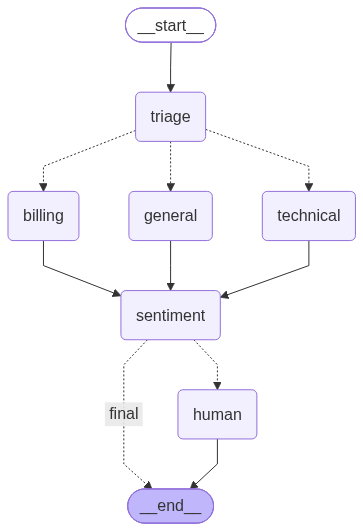
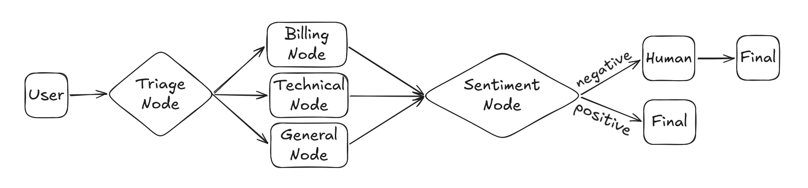
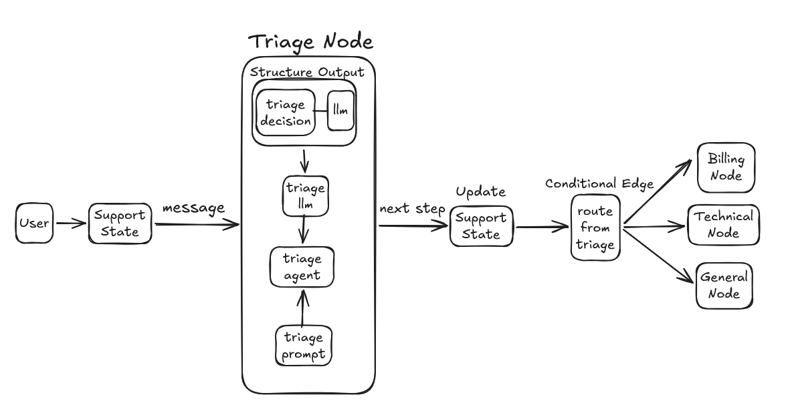
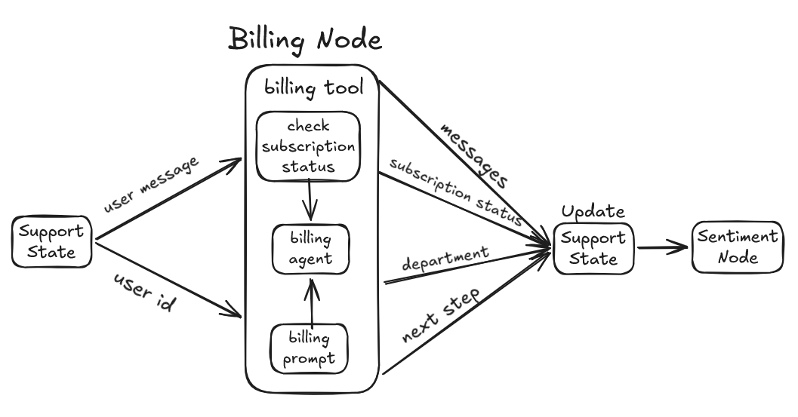
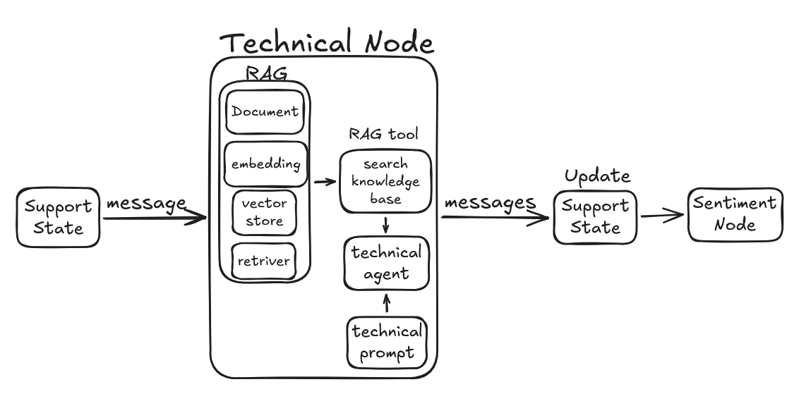
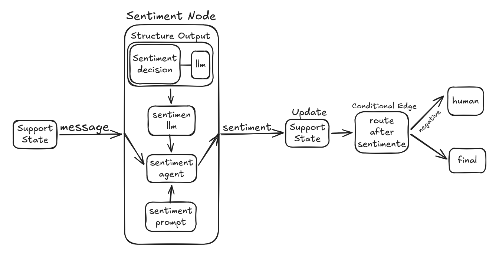
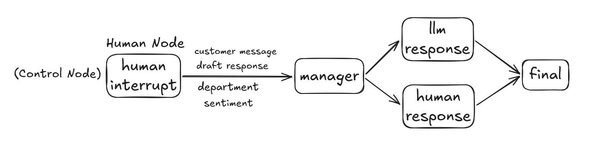
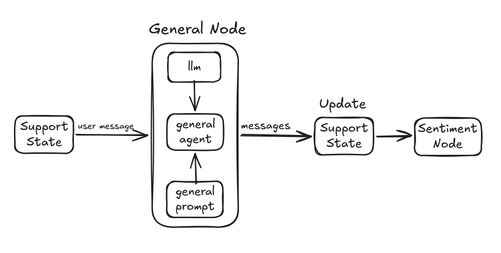

# 🤖 Multi-Agent Customer Support & Credit Allocation System

An advanced, production-ready multi-agent customer support workflow built using **LangGraph**, **LangChain**, **Ollama (Llama 3.2)**, and **RAG (Retrieval-Augmented Generation)**. This system intelligently routes customer inquiries, evaluates account statuses, retrieves technical documentation, monitors sentiment, and implements a Human-in-the-Loop escalation mechanism.

---

## 🌟 Architecture & Overall Flow

The system is structured as a stateful graph (`StateGraph`) where specialized agents collaborate to handle customer requests efficiently:



---

## 🔍 Detailed Node Breakdown & Mechanics

### 1. Triage Node
Classifies incoming customer messages into specific departments (`Billing`, `Technical`, `General`) using Pydantic structured output.


### 2. Billing Node
Manages subscription statuses, payments, and transaction queries using custom tools and mock databases.


### 3. Technical Node (RAG Pipeline)
Answers complex technical troubleshooting questions by performing semantic search over local documentation (`FAISS` vector store + HuggingFace embeddings).


### 4. General Node
Handles polite greetings, general inquiries, and basic customer requests.


### 5. Sentiment Analysis Node
Evaluates the emotional tone (`Positive`, `Neutral`, `Negative`) of the conversation to detect angry or dissatisfied users.


### 6. Human-in-the-Loop / Control Node
Automatically interrupts the workflow on strongly negative sentiment or angry customer tones, allowing a human manager to review draft responses and provide overrides or manual resolutions via LangGraph `interrupt` and `Command(resume=...)`.


---

## 📊 Compiled LangGraph Execution Flow

The compiled state graph execution and routing logic:


---

## 📁 Project Structure

```text
├── Multi Agent.ipynb              # Complete implementation of graph, agents, RAG, and tests
├── overall_architecture/          # Architecture and node workflow diagrams
│   ├── 0.png ... 7.png
└── README.md                      # Project documentation
